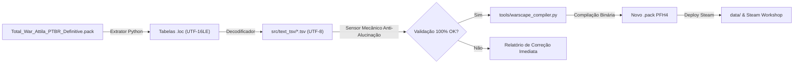

# 🏛️ Total War: Attila - Localização PT-BR Definitiva & Modding Toolkit

[](https://github.com/ArmandoFilho483/total-war-attila-ptbr/actions)
[](https://opensource.org/licenses/MIT)
[](https://store.steampowered.com/app/325610/Total_War_ATTILA/)
[](#)
[](#)

Projeto oficial de **Localização em Português do Brasil de Alta Fidelidade** para *Total War: Attila*, construído com foco rigoroso em autenticidade histórica, terminologia tática militar de época e linguagem gamer/PC natural adotada no Brasil.

---

## 🌟 Destaques da Tradução

- **Rigor Histórico e Tático:** Preservação integral dos nomes originais de regimentos em latim, grego e germânico arcaico (*Ballistarii*, *Herculiani Seniores*, *Comitatenses*, *Cataphracti*, *Equites*).
- **Adequação Militar de Época:** Eliminação total de jargões bélicos anacrônicos (substituição sistemática de *"mísseis"* por **Projéteis / Unidades de Disparo / Atiradores**; *"cargas de cavalaria"* por **Investidas de Cavalaria**; *"fogo à vontade"* por **Disparar à Vontade**; *"sobre o rosto"* por **Meia-Volta**).
- **Cultura Gamer de PC:** Padrão limpo nos menus e controles (teclas físicas padronizadas como *Shift*, *Ctrl*, *Alt*, *Space*, *Enter*, *Backspace*, *Caps Lock*, *NumPad*; preservação de *Mouse* eliminando traduções europeias como "rato").
- **Árvore Tecnológica Saneada:** Remoção de mais de 100 placeholders legados da desenvolvedora, restaurando os nomes civis e militares de todas as árvores culturais.

---

## 🏗️ Arquitetura do Projeto

Consulte a documentação técnica completa em [docs/ARQUITETURA.md](docs/ARQUITETURA.md).



---

## 📥 Como Instalar no Jogo

### Método 1: Via Download Manual da Release
1. Baixe o pacote `Total_War_Attila_PTBR_Definitive.pack` na seção de [Releases](https://github.com/ArmandoFilho483/total-war-attila-ptbr/releases).
2. Copie o arquivo para a pasta `data` do seu jogo:
   ```
   C:\Program Files (x86)\Steam\steamapps\common\Total War Attila\data\
   ```
3. Abra o inicializador do jogo pela Steam, clique em **Gerenciador de Mods** (*Mod Manager*) e ative o mod.

### Método 2: Via Steam Workshop
- Inscreva-se diretamente na página da Workshop da comunidade Total War: Attila.

---

## 🛠️ Ferramentas Locais de Modding

O projeto disponibiliza utilitários CLI completos em Python para permitir empacotamento idempotente sem depender de softwares proprietários externos:

```bash
# Auditar anomalias em todas as 171 tabelas TSV
python tools/warscape_compiler.py audit --dir src/text_tsv

# Converter tabela individual TSV para arquivo binário .loc
python tools/warscape_compiler.py tsv-to-loc --input src/text_tsv/land_units.tsv --output build/land_units.loc

# Extrair qualquer arquivo .pack (PFH4) da Creative Assembly
python tools/warscape_compiler.py extract-pack --pack "caminho/para/mod.pack" --output temp_extracted/
```

---

## ⚖️ Licença

Distribuído sob a licença [MIT](LICENSE). Consulte o arquivo para obter mais informações. Total War: Attila é marca registrada da Creative Assembly e SEGA.
