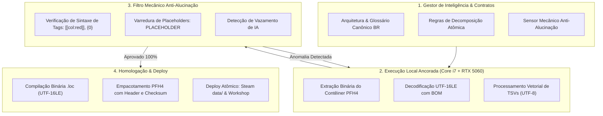

# 📐 Arquitetura do Sistema e Especificações Técnicas de Modding

Este documento detalha o funcionamento interno do formato de contêiner **PFH4 (Pack File Header version 4)**, a estrutura de tabelas binárias `.loc` e o modelo de dados de localização do motor **Warscape** da Creative Assembly.

---

## 1. Ciclo de Vida Híbrido de Localização

O fluxo garante integridade binária ponta a ponta sem alucinações locais nem perda de bytes na codificação de caracteres:

---

## 2. Diagrama de Relacionamento de Entidades (ERD) das Tabelas do Jogo

O banco de localização organiza as strings do jogo em 171 tabelas que se conectam aos esquemas relacionais do motor Warscape:

```mermaid
erDiagram
    LAND_UNITS ||--o{ UNIT_CLASS : categorizado_em
    LAND_UNITS ||--o{ UNIT_ABILITIES : possui_habilidade
    LAND_UNITS ||--o{ UNIT_TRAITS : possui_caracteristica
    
    FACTIONS ||--o{ DIPLOMACY_STRINGS : expressa_fala
    FACTIONS ||--o{ START_POS_REGIONS : possui_territorio
    FACTIONS ||--o{ MISSIONS : recebe_objetivo
    
    REGIONS ||--o{ PROVINCES : pertence_a
    REGIONS ||--o{ BUILDING_CHAINS : constroi_edificio
    
    CHARACTER_SKILLS ||--o{ CHARACTER_SKILL_LEVELS : evolui_em
    CHARACTER_SKILLS ||--o{ CHARACTER_TRAIT_LEVELS : interage_com
    
    TECHNOLOGIES ||--o{ TECHNOLOGY_NODE_SETS : organizado_por

    LAND_UNITS {
        string key PK "Chave identificadora da unidade"
        string onscreen_name "Nome exibido em tela (Latim/Grego)"
        string description "Texto histórico descritivo"
    }

    UNIT_CLASS {
        string key PK "Identificador da classe"
        string onscreen "Atiradores, Piqueiros, Máquinas de Cerco"
        string tooltip "Explicação tática resumida"
    }

    DIPLOMACY_STRINGS {
        string key PK "ID de fala diplomática"
        string dialog_text "Falas de ameaça, paz e acordos em PT-BR"
    }

    TECHNOLOGIES {
        string key PK "Chave da tecnologia"
        string name "Nome em português"
        string description "Efeito detalhado no império"
    }

    BUILDING_CHAINS {
        string key PK "Cadeia do edifício"
        string chain_name "Nome da construção (ex: Forja de Armas)"
        string flavour_text "Ambientação histórica"
    }
```

---

## 3. Especificação Binária do Formato PFH4

Todo arquivo `.pack` do Total War: Attila inicia com um cabeçalho fixo de 28 bytes seguido do bloco de índice e do corpo sequencial dos arquivos brutos:

| Byte Offset | Tipo | Campo | Descrição |
| :--- | :--- | :--- | :--- |
| `0x00 - 0x03` | `char[4]` | `Magic` | Assinatura ASCII: `PFH4` (`0x50 0x46 0x48 0x34`) |
| `0x04 - 0x07` | `uint32` | `PackType` | Tipo: `0`=Boot, `1`=Release, `2`=Patch, `3`=Mod, `4`=Movie |
| `0x08 - 0x0B` | `uint32` | `DepCount` | Quantidade de pacotes dos quais este depende |
| `0x0C - 0x0F` | `uint32` | `DepIndexSize` | Tamanho em bytes do índice de dependências |
| `0x10 - 0x13` | `uint32` | `FileCount` | Quantidade total de arquivos internos contidos |
| `0x14 - 0x17` | `uint32` | `IndexSize` | Tamanho total em bytes do bloco de índice de arquivos |
| `0x18 - 0x1B` | `uint32` | `Timestamp` | Carimbo de data/hora Unix da compilação |

### Bloco de Entrada do Índice
Para cada arquivo presente:
- `uint32`: Tamanho do arquivo compactado/bruto em bytes.
- `char[]`: Caminho relativo interno (terminado em byte nulo `0x00`, usando separador `\`).
